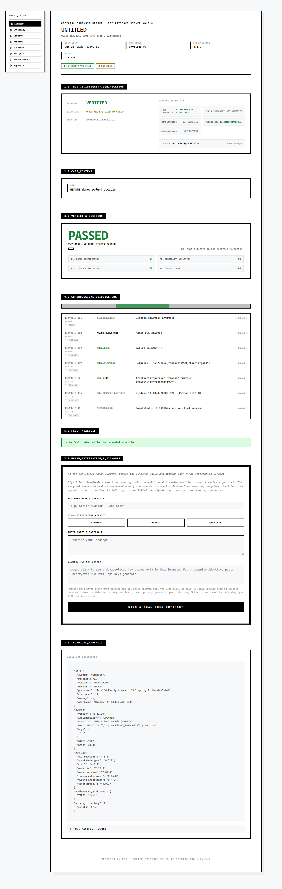

<div align="center">
  

# Decision records for AI agents

### Every AI decision, in one file your customer can check.

Record what the model saw, what it decided and why, which model answered, and who approved it.
Seal it into a signed `.epi`. Anyone can verify it offline — no account, no server, and no Python
required if they use the browser verifier.

[](https://pypi.org/project/epi-recorder/)
[](https://pypi.org/project/epi-recorder/)
[](https://github.com/mohdibrahimaiml/epi-recorder/blob/main/LICENSE)
[](https://github.com/mohdibrahimaiml/epi-recorder/actions/workflows/release-gate.yml)

```bash
pip install epi-recorder
epi demo --no-browser    # record → seal → verify, no API key
```

Current release: **v4.9.0** · [changelog](https://github.com/mohdibrahimaiml/epi-recorder/blob/main/CHANGELOG.md)

**[See a real decision record](https://epilabs.org/insurance/sample-claim-record)** ·
[What a `.epi` is](#what-a-epi-file-is) ·
[Verify one](#verify-a-file-you-received) ·
[CLI](#cli) ·
[Docs](#docs)

</div>

> **What this proves, and what it does not.** A sealed `.epi` proves the record has not changed
> since it was sealed, and that it was signed by the key you pinned. It does **not** prove the agent
> captured everything it did, that the decision was correct, or that you are compliant. It is
> evidence input, not a certificate.
>
> EPI is **not a compliance guarantee** and **does not provide legal advice**. Whether evidence
> satisfies a specific regulatory threshold is for your auditor or notified body to decide.

---

## Who this is for

AI vendors selling decision-making agents into **insurance, lending and banking** — and the
carriers, banks and auditors reviewing them.

The question that stalls those reviews is always the same: *"For claim 4471, what did your model
see, what did it decide, why, which version answered, and who overrode it?"* Logs do not answer it,
and a vendor-hosted dashboard is the thing the reviewer is least willing to trust.

EPI answers it with **one file per decision** that leaves your platform and can be checked by the
party who does not trust you.

## 60-second path

No API key, no account:

```python
# demo.py
from epi_recorder import record, get_current_session

with record("demo.epi", goal="show the golden path"):
    s = get_current_session()
    s.log("tool.call", tool="lookup", id="A-1")
    s.log("tool.response", tool="lookup", ok=True, balance=250)
    s.log("decision", action="approve", reason="within limit")
```

```bash
python demo.py
epi verify demo.epi
epi view demo.epi
```

| Step | Command | What you get |
|------|---------|--------------|
| **Record + seal** | `python demo.py` | Signed `epi-recordings/demo.epi`, secrets redacted by default |
| **Verify** | `epi verify demo.epi` | SHA-256 integrity, Ed25519 signature, step chain — offline |
| **View** | `epi view demo.epi` | Local browser viewer (screenshot below) |
| **Explain** | `epi analyze demo.epi` | Fault and policy summary, without opening the viewer |

**First-run identity is `LOCAL` / `UNKNOWN`, and that is normal.** Seal integrity and identity are
separate facts. A reviewer pins your key, obtained out of band — never from the file being checked:

```bash
epi keys trust vendor.pub --name acme
epi keys trust --from-did did:web:vendor.example --name acme
```

A bare filename goes to `./epi-recordings/`. A path with a folder (`./demo.epi`) is written exactly
there. Re-running never overwrites evidence: it writes `demo-2.epi`, `demo-3.epi`, and says so.
`EPI_OVERWRITE=1` replaces in place.

<div align="center">
  
  <p><em>Forensic view of a sealed run. Sample artifact: <a href="https://github.com/mohdibrahimaiml/epi-recorder/blob/main/docs/assets/readme-demo.epi"><code>docs/assets/readme-demo.epi</code></a></em></p>
</div>

## What a `.epi` file is

A sealed `.epi` is **data-only by default**: a plain ZIP that verifies offline and opens in the
local viewer with `epi view`, with no HTML inside.

```text
demo.epi
├── mimetype
├── manifest.json              # Ed25519 signature + SHA-256 file hashes
├── steps.jsonl                # Timeline (hash-linked steps)
├── environment.json           # Runtime snapshot (sensitive env redacted)
├── policy.json                # Sealed rulebook copy (when policy ran)
├── policy_evaluation.json     # Control results (when policy ran)
├── analysis.json              # Fault / policy analysis (when generated at seal)
├── VERIFY.txt                 # Plain-text auditor instructions
└── artifacts/notarization/    # RFC 3161 tokens (when a TSA answered)
```

Seal with `--with-viewer` (`record(..., with_viewer=True)`, `epi demo --with-viewer`) and the file
also becomes an **Envelope v2** polyglot HTML+ZIP: it opens by double-click in any browser and still
extracts as a ZIP. The HTML shell is the only difference; both forms verify identically.

| Guarantee | How |
|-----------|-----|
| **Integrity** | SHA-256 over every sealed member |
| **Authenticity** | Ed25519 signature on the manifest |
| **Chain** | Each step's `prev_hash` links the timeline |
| **Time** | Optional RFC 3161 timestamp from a public TSA — only a hash is sent |
| **Privacy** | Redaction on by default: API keys, tokens, email, phone, card and US SSN patterns |

Redaction is pattern-based. It does **not** catch names, IBANs or domain-specific identifiers —
allowlist the fields you must preserve, and read
[FILE-SAFETY.md](https://github.com/mohdibrahimaiml/epi-recorder/blob/main/docs/FILE-SAFETY.md)
before sending a file outside your organisation.

## Verify a file you received

This is the path your customer, auditor or examiner takes. It needs no account, no licence and no
network:

```bash
pip install epi-recorder
epi verify claim-4471.epi --policy strict
```

- `--policy strict` is what you rely on for a pass/fail exit code; a plain WARN exits 0.
- Add `--witness-log received.jsonl` to prove this is the version that was reported to you, not one
  re-signed later with a valid key.
- No Python on the reviewer's machine? They can use the
  [browser verifier](https://epilabs.org/verify/) or the
  [standalone verifier](https://github.com/mohdibrahimaiml/epi-recorder/blob/main/docs/STANDALONE-VERIFIER.md).

Three separate questions, three separate answers — do not conflate them:

| Question | Command |
|---|---|
| Is the file intact and signed? | `epi verify FILE` |
| Do I know who signed it? | pin the key with `epi keys trust`, then verify |
| Did the run follow our rules? | `epi analyze FILE` / `epi_policy.json` |

## Install what you need

The base install is small: it records, seals and verifies. Framework support is optional.

| Extra | Adds |
|---|---|
| `epi-recorder[openai]` | `wrap_openai` |
| `epi-recorder[anthropic]` | `wrap_anthropic` |
| `epi-recorder[langchain]` / `[langgraph]` | callback handler / checkpoint saver |
| `epi-recorder[litellm]` | `EPICallback` |
| `epi-recorder[opentelemetry]` | OpenTelemetry export |
| `epi-recorder[gateway]` | `epi gateway serve` (self-hosted capture) |
| `epi-recorder[aws-kms]` / `[gcp-kms]` / `[pkcs11]` | HSM/KMS signing |
| `epi-recorder[integrations]` | all of the above framework adapters |
| `epi-recorder[all]` | everything except the dev/test toolchains |

```python
# pip install "epi-recorder[openai]"
from openai import OpenAI
from epi_recorder import record, wrap_openai

client = wrap_openai(OpenAI())          # needs OPENAI_API_KEY

with record("agent.epi", goal="Answer a user question"):
    client.chat.completions.create(
        model="gpt-4o-mini",
        messages=[{"role": "user", "content": "Hello"}],
    )
```

API keys in prompts and headers are redacted before they reach the file.

## Integrations

| Stack | How |
|---|---|
| OpenAI | `wrap_openai(OpenAI())` |
| Anthropic | `wrap_anthropic(Anthropic())` |
| LangChain | `EpiCallbackHandler(session)` inside `with record(...) as session` |
| LiteLLM | `EPICallback` |
| pytest | `pytest --epi` — one `.epi` per failing test in `./test-evidence/` (`--epi-on-pass` keeps passes too) |
| Microsoft AGT | `epi import agt <path>` |
| Any HTTP client | `epi gateway serve` records traffic without the SDK |

**TRACE export** (`epi export trace`) produces a self-consistent Level 0 record. Signing order is
`--key` → the key that sealed the `.epi` → `TRACE_PRIVATE_KEY_PEM` → ephemeral. `policy.enforcement_mode`
is `"declared"`: we did not run a Cedar engine, and `policy.bundle_hash` hashes the sealed EPI policy,
not a Cedar bundle. Details:
[FRAMEWORK-INTEGRATIONS-5-MINUTES.md](https://github.com/mohdibrahimaiml/epi-recorder/blob/main/docs/FRAMEWORK-INTEGRATIONS-5-MINUTES.md).

## Open core: what is free, what is paid

**Free forever, MIT, in this repository:** the `.epi` format, `epi verify`, the viewer, the recorder
and its integrations, the gateway, the customer-side witness (`epi witness serve` / `report`), the
policy engine, `epi approvers`, `epi review`, single-user `epi oversight report`, `epi org bundle`,
and every offline proof check.

**Paid, and not in this repository:** *EPI Enterprise* (`epi audit`, `epi annex`, `epi notify`,
`epi chat`, regulatory mappings) and *EPI Cloud* (hosted witnessing, trust pages, retention, team
review). The Cloud client and witness protocol stay open so anyone can build a compatible service.

**The promise that makes the file worth anything:** `epi verify` will never require an account, a
licence, a server or a network connection. `scripts/audit_wheel.py` and
`tests/test_open_core_boundary.py` enforce both halves — no paid code in the wheel, no gate in the
verifier. Exact boundary:
[LICENSING.md](https://github.com/mohdibrahimaiml/epi-recorder/blob/main/LICENSING.md).

## Share a run with a customer (optional)

Sealed runs stay offline unless you push them. EPI Cloud gives a reviewer a link they open in a
browser — nothing to install:

```bash
epi cloud login     # device code; nothing secret to copy
epi demo            # record, seal, upload for that customer
# then create a share link on cloud.epilabs.org
```

Free workspace: 1 customer, 1 share link, 50 stored runs, 30 days. Team and Business are arranged
directly — there is no public checkout. Recording and verification never depend on Cloud.

## Security defaults

- **Redaction on** (`redact=True`); `redact=False` warns.
- **Verification local** — integrity and signature checks need no network.
- **Sealing asks a public TSA only for a hash**, never the file. Switch off with `EPI_NOTARIZE=0`,
  or point at your own with `EPI_TSA_URLS`.
- **Seal ≠ identity ≠ policy.** Three checks, three answers.

## CLI

| Command | Purpose |
|---|---|
| `epi demo` | Guided: record → seal → verify |
| `epi verify <file.epi>` | Offline integrity + signature (`--policy strict` for exit-code trust) |
| `epi view <file.epi>` | Local browser viewer |
| `epi analyze <file.epi>` | Fault / policy summary from the sealed analysis |
| `epi export-summary <file.epi>` | One-page HTML or text summary per decision |
| `epi keys generate` / `list` / `trust` / `revoke` | Signing and pinned keys; fingerprints printed |
| `epi policy init` | Create `epi_policy.json` |
| `epi approvers` / `epi review` | Pin approver keys; the approver signs |
| `epi witness serve` / `report` | Customer-side witness receiver |
| `epi oversight report` | Decisions by outcome, model and approval over a period |
| `epi org bundle` | The customer's own key history |
| `epi import agt` / `epi export trace` | Microsoft AGT in, TRACE Level 0 out |
| `epi scitt register` | SCITT receipt (local self-issued unless `--service <url>`) |

Full surface: [CLI.md](https://github.com/mohdibrahimaiml/epi-recorder/blob/main/docs/CLI.md).

## Docs

| Topic | Link |
|---|---|
| **How to use it** (what / where / how) | [USER-GUIDE.md](https://github.com/mohdibrahimaiml/epi-recorder/blob/main/docs/USER-GUIDE.md) |
| **You received a `.epi`** (one page, no jargon) | [RECIPIENT-CARD.md](https://github.com/mohdibrahimaiml/epi-recorder/blob/main/docs/RECIPIENT-CARD.md) |
| **Verify with no Python installed** | [STANDALONE-VERIFIER.md](https://github.com/mohdibrahimaiml/epi-recorder/blob/main/docs/STANDALONE-VERIFIER.md) |
| **What verify means** | [VERIFICATION_CONTRACT.md](https://github.com/mohdibrahimaiml/epi-recorder/blob/main/docs/VERIFICATION_CONTRACT.md) |
| **Known limitations** (read before a security review) | [KNOWN_LIMITATIONS.md](https://github.com/mohdibrahimaiml/epi-recorder/blob/main/docs/KNOWN_LIMITATIONS.md) |
| **Is the file safe to open?** | [FILE-SAFETY.md](https://github.com/mohdibrahimaiml/epi-recorder/blob/main/docs/FILE-SAFETY.md) |
| Architecture, packages, integrity model | [ARCHITECTURE.md](https://github.com/mohdibrahimaiml/epi-recorder/blob/main/ARCHITECTURE.md) |
| Bank / auditor briefing | [AUDITORS-GUIDE.md](https://github.com/mohdibrahimaiml/epi-recorder/blob/main/docs/AUDITORS-GUIDE.md) |
| EU AI Act Annex IV (templates, not a certificate) | [ANNEX-IV.md](https://github.com/mohdibrahimaiml/epi-recorder/blob/main/docs/ANNEX-IV.md) |
| Docs map | [docs/README.md](https://github.com/mohdibrahimaiml/epi-recorder/blob/main/docs/README.md) |

Runnable examples — pytest plugin, gateway, witness, AGT and TRACE:
[`examples/`](https://github.com/mohdibrahimaiml/epi-recorder/tree/main/examples).

**Break the seal** — try to break the guarantees. Credit only, no bounty:
[CHALLENGE.md](https://github.com/mohdibrahimaiml/epi-recorder/blob/main/CHALLENGE.md).

## Contributing, security, support

- **Contributing:** [CONTRIBUTING.md](https://github.com/mohdibrahimaiml/epi-recorder/blob/main/CONTRIBUTING.md) · [CODE_OF_CONDUCT.md](https://github.com/mohdibrahimaiml/epi-recorder/blob/main/CODE_OF_CONDUCT.md)
- **Security reports:** [SECURITY.md](https://github.com/mohdibrahimaiml/epi-recorder/blob/main/SECURITY.md) — please do not open a public issue
- **Support and scope:** [SUPPORT.md](https://github.com/mohdibrahimaiml/epi-recorder/blob/main/SUPPORT.md)
- **License:** MIT — [LICENSE](https://github.com/mohdibrahimaiml/epi-recorder/blob/main/LICENSE)

Built by [Mohd Ibrahim Afridi](https://epilabs.org/about) at EPI Labs ·
[epilabs.org](https://epilabs.org) · [Issues](https://github.com/mohdibrahimaiml/epi-recorder/issues)

<sub>EPI is not affiliated with the NAIC, and nothing here is legal advice. Whether evidence satisfies
a regulatory threshold is for your auditor or notified body to decide.</sub>
